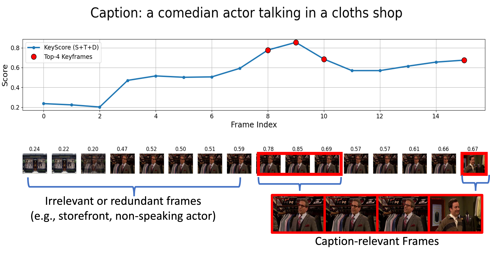
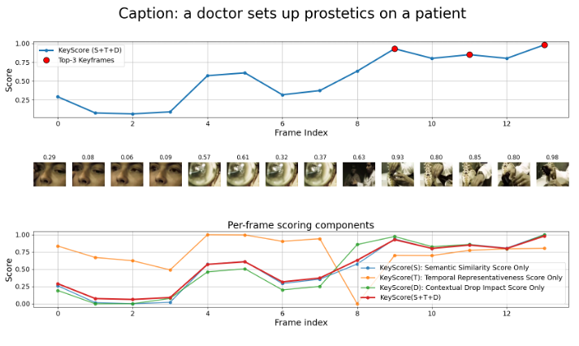

# KeyScore

**Query-Conditioned Frame Utility for Efficient Video Understanding**

[](https://arxiv.org/abs/2510.06509)
[](LICENSE)

KeyScore is a **training-free** frame-selection front-end for frozen video-language
models. Instead of sampling frames uniformly, it asks a simple question for every
candidate frame: *how much does keeping this frame change the model's answer to
**this** query?*

The result is a compact, query-dependent subset of frames — typically **~4 frames
per video** — that consistently beats uniform sampling at equal or lower compute.

<p align="center">
  
</p>

---

## Table of contents

- [Why](#why)
- [Method](#method)
- [Key results](#key-results)
- [Environment setup](#environment-setup)
- [Quickstart](#quickstart)
- [Runbook: reproducing the paper](#runbook-reproducing-the-paper)
- [Repository layout](#repository-layout)
- [Released result files](#released-result-files)
- [Qualitative examples](#qualitative-examples)
- [FAQ / troubleshooting](#faq--troubleshooting)
- [Citation](#citation)
- [License](#license)

---

## Why

Frozen video-language models are usually fed a **fixed, query-agnostic** frame
budget (e.g. uniform 8 frames). This wastes compute on redundant frames and, worse,
often misses the few frames that actually answer the question.

Simply spending more compute does not fix this. On MSR-VTT, a uniform sampler that
encodes the *same* number of frames as our candidate pool still lands at 50.4 R@1,
while selecting **4.27** frames with KeyScore reaches **59.8** R@1 — a ~9-point gap
attributable to *which* frames are kept, not to extra computation.

## Method

KeyScore is a two-stage, training-free pipeline that sits between the decoder and a
frozen image-text encoder.

### Stage I — STACFP: Spatio-Temporal Adaptive Clustering Frame Proposal

A cheap, VLM-free proposal step that produces a small, redundancy-suppressed
candidate pool:

1. Decode every `frame_step`-th frame and build a 3D colour histogram (HSV or Lab).
2. Append the **normalized timestamp**, scaled by `gamma_time`, so clusters cannot
   span temporally distant but visually similar content.
3. Run KMeans, choosing `K` automatically via **silhouette score** in `[k_min, k_max]`.
4. Emit one representative frame per cluster (nearest to the centroid).

The video's own content decides how many candidates it needs — static clips yield
few, dynamic clips yield more.

### Stage II — KeyScore: query-conditioned frame utility

Each candidate frame $v_i$ is scored by three complementary, normalized signals
against the query embedding $w$ and the pooled video embedding $\bar{v}$:

| Signal | Definition | Question it answers |
| --- | --- | --- |
| **Semantic relevance** $S_\text{sem}$ | $\cos(v_i, w)$ | Does this frame match the query? |
| **Candidate-context representativeness** $S_\text{rep}$ | $\cos(v_i, \bar{v})$ | Is this frame typical of the video? |
| **Frame-drop contribution** $S_\text{drop}$ | $\cos(w,\bar{v}) - \cos(w,\bar{v}_{\setminus i})$ | Does removing it hurt the match? |

$$
\text{KeyScore}(v_i) = \alpha\,S_\text{sem} + \beta\,S_\text{rep} + \gamma\,S_\text{drop},
\qquad \alpha + \beta + \gamma = 1
$$

Frames scoring above a threshold $\tau$ are kept, so the **frame count adapts per
video and per query**. For mean pooling the leave-one-out term has a closed form, so
the whole scoring stage costs **~0.3 ms per video** (<0.02% of the pipeline) — no
extra encoder passes.

Defaults used in the paper: `alpha=0.7, beta=0.1, gamma=0.2`, `tau=0.5`,
STACFP `frame_step=5, gamma_time=5, k_min=6, k_max=30`.

## Key results

All numbers are **zero-shot**, with every backbone kept frozen.

**Video–text retrieval (R@1)** — KeyScore is a drop-in front-end and improves two
different encoders:

| Model | MSR-VTT T2V | MSR-VTT V2T | MSVD T2V | MSVD V2T | DiDeMo T2V | DiDeMo V2T |
| --- | --- | --- | --- | --- | --- | --- |
| ViCLIP | 42.4 | 41.3 | 49.1 | 75.1 | 31.5 | 31.5 |
| **ViCLIP + KeyScore** | **51.3** | **49.8** | **57.9** | **83.4** | **41.2** | **40.9** |
| PE-Core-G Video | 51.2 | 49.9 | 59.7 | 85.4 | 43.1 | 45.1 |
| **PE-Core-G Video + KeyScore** | **63.9** | **60.5** | **89.2** | **89.2** | **60.4** | **60.3** |

**Video QA — Video-MME (no subtitles, Qwen2-VL 7B):**

| Method | Frames | Overall |
| --- | --- | --- |
| Qwen2-VL | 8 | 53.0 |
| Q-Frame | 4+8+32 | 58.3 |
| AKS | 32 | **59.9** |
| **KeyScore** | **8** | 59.4 |

KeyScore reaches near-parity with a 32-frame selector using **one quarter** the frames.

**Compute fairness (MSR-VTT, 1k videos, A100, per-video seconds):**

| Method | Frames | Sampling | Embedding | Scoring | Total | R@1 (T2V) |
| --- | --- | --- | --- | --- | --- | --- |
| UFP-8 | 8.00 | 0.085 | 1.476 | – | 1.561 | 50.3 |
| UFP (compute-matched) | 7.70 | 0.072 | 1.263 | – | 1.335 | 50.4 |
| UFP (frame-matched) | 4.27 | 0.042 | 0.749 | – | 0.791 | 47.0 |
| **STACFP + KeyScore** | **4.27** | 0.650 | 1.263 | 0.0003 | 1.914 | **59.8** |

**Zero-shot action classification (HMDB-51):** F1 **0.675** with PE-Core-G Video + KeyScore.
The selection threshold is swept and the best operating point reported, so this figure
is an optimistic upper bound; see [`docs/RESULTS.md`](docs/RESULTS.md) §8.

> Full tables, ablations and sensitivity sweeps are in [`docs/RESULTS.md`](docs/RESULTS.md).

---

## Environment setup

Tested on Linux with Python 3.10+, CUDA 12.x and a single A100. A GPU is strongly
recommended; CPU works but is slow.

### 1. Clone and create an environment

```bash
git clone https://github.com/mikeslin-ir/keyscore.git
cd keyscore

conda create -n keyscore python=3.10 -y
conda activate keyscore
# or: python -m venv .venv && source .venv/bin/activate
```

### 2. Install PyTorch matching your CUDA version

```bash
# CUDA 12.1 example — see https://pytorch.org for other builds
pip install torch torchvision --index-url https://download.pytorch.org/whl/cu121
```

### 3. Install the remaining dependencies

```bash
pip install -r requirements.txt
```

Optional extras, only needed for specific experiments:

```bash
pip install katna scenedetect        # SCFP shot-based proposal baseline
pip install accelerate qwen-vl-utils # Video QA with Qwen2-VL
```

### 4. Point the code at your datasets

Every script resolves dataset paths from a single environment variable:

```bash
export KEYSCORE_DATA_ROOT=/path/to/your/datasets
```

Expected layout (only the datasets you actually evaluate are required):

```
$KEYSCORE_DATA_ROOT/
├── MSRVTT/
│   ├── videos/all/
│   ├── annotation/MSR_VTT.json
│   └── structured-symlinks/test_list_miech.txt
├── MSVD/
│   ├── YouTubeClips/
│   ├── AllVideoDescriptions.txt
│   └── annotaions/msvd_data/test_list.txt
├── DiDeMo/
│   ├── video/test/
│   └── didemo_test.json
├── MLVU/
└── EgoSchema/
```

Backbone weights are pulled from the Hugging Face Hub on first use
(`timm/PE-Core-bigG-14-448`). Set `HF_HOME` if you want to control the cache
location. No KeyScore-specific checkpoints exist — the method is training-free.

### 5. Verify the install

```bash
python -c "
import torch
from keyscore.scoring import FrameScorer, MeanPooling
s = FrameScorer(MeanPooling(), alpha=0.7, beta=0.1, gamma=0.2)
out = s.compute(torch.randn(12, 256), torch.randn(256))
print('OK:', out['scores'].shape, '| cuda:', torch.cuda.is_available())
"
```

Expected output: `OK: torch.Size([12]) | cuda: True`.

---

## Quickstart

### Select frames for a single video and query

```python
from keyscore.proposals import FrameSampler_STACFP
from keyscore.encoders.perception_encoder import PerceptionEncoder
from keyscore.scoring import FrameScorer, MeanPooling

query = "a man is playing an acoustic guitar on stage"

# Stage I — candidate proposals (no VLM involved)
sampler = FrameSampler_STACFP(frame_step=5, gamma_time=5.0, k_min=6, k_max=30)
candidate_paths = sampler.extract_frames("video.mp4", "out/candidates")

# Frozen backbone: encode candidates once, reuse for every query
encoder = PerceptionEncoder()                                # PE-Core bigG/14 @ 448
frame_embs = encoder.encode_images(candidate_paths)          # [N, D]
text_emb = encoder.encode_text([query])[0]                   # [D]

# Stage II — query-conditioned utility
scorer = FrameScorer(MeanPooling(), alpha=0.7, beta=0.1, gamma=0.2)
out = scorer.compute(frame_embs, text_emb)

keep = out["scores"] >= 0.5                                  # adaptive frame count
selected = [p for p, k in zip(candidate_paths, keep.tolist()) if k]
print(f"{len(candidate_paths)} candidates -> {len(selected)} selected")
```

### Fixed budget instead of a threshold

```python
import torch

k = 8
topk = torch.topk(out["scores"], k=min(k, out["scores"].numel())).indices
selected = [candidate_paths[i] for i in sorted(topk.tolist())]   # temporal order
```

### Inspect the individual signals

```python
for name in ["sim_semantic", "sim_temporal", "sim_drop", "scores"]:
    print(f"{name:13s}", out[name].round(decimals=3).tolist())
```

`sim_temporal` is the candidate-context representativeness term $S_\text{rep}$
(the key is kept for backwards compatibility).

### Score many queries against one video

Candidate embeddings are computed **once**; each additional query only costs a text
encode plus the ~0.3 ms scoring pass.

```python
queries = ["a dog catches a frisbee", "two people are cooking", "a car drives at night"]
text_embs = encoder.encode_text(queries)                     # [Q, D]

for q, t in zip(queries, text_embs):
    scores = scorer.compute(frame_embs, t)["scores"]
    print(q, "->", (scores >= 0.5).sum().item(), "frames")
```

---

## Runbook: reproducing the paper

All commands assume `KEYSCORE_DATA_ROOT` is exported and you are at the repo root.
Results are written to `outputs/` (git-ignored); reference copies of our runs live
in [`results/`](results/).

### Retrieval (Table: zero-shot retrieval)

The retrieval evaluation is split into two stages so the expensive embedding pass is
cached and reused across scoring configurations.

```bash
# Stage 1 — sample candidate frames and embed them (writes _msrvtt/embeddings/*)
python scripts/retrieval/msrvtt_eval_base.py

# Stage 2 — score, select and evaluate R@1/5/10
python scripts/retrieval/msrvtt_eval_scoring.py
```

Swap `msrvtt` for `msvd` or `didemo` to reproduce the other two datasets.

### Compute fairness and runtime (Table: full-pipeline runtime)

Compares UFP-8, compute-matched UFP, frame-matched UFP and STACFP+KeyScore on the
same backbone and the same videos.

```bash
python scripts/benchmark_msrvtt_mini_runtime.py \
    --list $KEYSCORE_DATA_ROOT/MSRVTT/structured-symlinks/test_list_miech.txt \
    --out outputs/runtime_1k
```

Reference output: [`results/msrvtt_runtime_1k.json`](results/msrvtt_runtime_1k.json).

### Is the gain just "using the query"? (Table: query-aware comparison)

This is the controlled ablation: **all** methods share the same frozen backbone and
the same STACFP candidates, and `QueryTopK` is frame-matched to KeyScore. Only the
selection rule differs.

```bash
python scripts/eval_query_aware_baseline.py \
    --threshold 0.5 \
    --out outputs/query_aware
```

Reference output: [`results/msrvtt_query_aware.json`](results/msrvtt_query_aware.json).

| Method | ASF | T2V R@1 | T2V R@5 | T2V R@10 | V2T R@1 |
| --- | --- | --- | --- | --- | --- |
| STACFP-mean (no selection) | 7.70 | 49.0 | 73.8 | 81.3 | 49.3 |
| UFP-8 | 8.00 | 50.3 | 74.1 | 81.8 | 48.9 |
| QueryTopK (frame-matched) | 4.27 | 59.7 | 80.2 | 88.9 | 58.7 |
| **KeyScore (S+T+D)** | **4.27** | **59.8** | 80.2 | 88.9 | 58.7 |

Selection — not merely conditioning on the query — accounts for the jump from ~50 to
~60 R@1, at roughly half the frames.

### STACFP timestamp-weight sensitivity (Table: gamma_time sweep)

```bash
python scripts/eval_gamma_time_sweep.py \
    --gammas 0 1 2 5 10 20 \
    --limit 300 \
    --out outputs/gamma_sweep
```

Reference output: [`results/msrvtt_gamma_time_sweep.json`](results/msrvtt_gamma_time_sweep.json).
Accuracy is flat (71.3–72.7 R@1) while the frame count falls from 5.44 to 3.54, i.e.
`gamma_time` trades frames for free rather than trading accuracy.

### Video QA — MLVU

```bash
python scripts/videoqa/mlvu_qa_eval.py \
    --mlvu_root $KEYSCORE_DATA_ROOT/MLVU \
    --out_dir outputs/mlvu_keyscore \
    --tasks 2_needle 6_anomaly_reco 4_count 5_order \
    --n_candidates 32 --k 8 \
    --model_id Qwen/Qwen2-VL-7B-Instruct
```

Reference output: [`results/mlvu_summary.json`](results/mlvu_summary.json)
(uniform 49.3 / relevance-only top-K 57.4 / KeyScore 57.1 over 1018 questions;
KeyScore's advantage concentrates on needle-in-a-haystack retrieval, 74.2 vs 60.9
for uniform).

### Video QA — EgoSchema

```bash
python scripts/videoqa/egoschema_qa_eval.py \
    --ego_root $KEYSCORE_DATA_ROOT/EgoSchema \
    --out_dir outputs/egoschema_keyscore \
    --n_candidates 32 --k 8 \
    --model_id Qwen/Qwen2-VL-7B-Instruct
```

### Video QA — MSVD-QA

MSVD-QA reads cached frame embeddings, so embed once first:

```bash
python scripts/videoqa/msvd_embed_frames.py \
    --frames_root $KEYSCORE_DATA_ROOT/MSVD/testing \
    --out_dir     $KEYSCORE_DATA_ROOT/MSVD/embeddings_stacfp \
    --video_ids   $KEYSCORE_DATA_ROOT/MSVD/test_stems.txt

python scripts/videoqa/msvd_qa_eval.py --out_dir outputs/msvd_qa
```

All QA scripts checkpoint to `*_checkpoint.jsonl`, so an interrupted run resumes
where it stopped.

---

## Repository layout

```
keyscore/
├── keyscore/                       # installable library
│   ├── proposals/
│   │   ├── stacfp.py               # Stage I: adaptive clustering frame proposals
│   │   ├── uniform.py              # UFP baseline
│   │   └── katna.py                # SCFP shot-based baseline
│   ├── scoring/
│   │   └── frame_scorer.py         # Stage II: KeyScore (S_sem / S_rep / S_drop)
│   └── encoders/
│       ├── perception_encoder.py   # PE-Core bigG/14 @ 448 (OpenCLIP)
│       └── clip_encoder.py         # CLIP / ViCLIP
├── scripts/
│   ├── eval_query_aware_baseline.py    # controlled query-aware ablation
│   ├── eval_gamma_time_sweep.py        # STACFP gamma_time sensitivity
│   ├── benchmark_msrvtt_mini_runtime.py# runtime + compute-fairness benchmark
│   ├── retrieval/                      # MSR-VTT / MSVD / DiDeMo (base + scoring)
│   └── videoqa/                        # MLVU / EgoSchema / MSVD-QA + Qwen2-VL runner
├── results/                        # JSON results backing the paper tables
├── assets/                         # figures from the paper
└── docs/
    ├── RESULTS.md                  # detailed result tables
    └── REPRODUCE.md                # end-to-end reproduction checklist
```

## Released result files

| File | Backs | Contents |
| --- | --- | --- |
| `results/msrvtt_query_aware.json` | Query-aware ablation | 1000 videos; STACFP-mean / UFP-8 / QueryTopK / KeyScore |
| `results/msrvtt_gamma_time_sweep.json` | STACFP sensitivity | 300 videos; `gamma_time` ∈ {0,1,2,5,10,20} |
| `results/msrvtt_runtime_1k.json` | Runtime + compute fairness | 1000 videos; per-stage wall-clock |
| `results/mlvu_summary.json` | MLVU QA | 1018 questions; overall + per-task accuracy |

Each file embeds a `metadata` block recording the exact hyperparameters
(`alpha/beta/gamma`, `threshold`, STACFP settings) used for that run.

## Qualitative examples

<p align="center">
  
</p>

<p align="center">
  
</p>

More examples in [`assets/qualitative/`](assets/qualitative/), including MSR-VTT
retrieval cases and Video-MME QA cases where uniform sampling misses the evidence
frame.

## FAQ / troubleshooting

**Do I need to train anything?**
No. KeyScore is training-free and adds no parameters. Backbones stay frozen.

**`alpha + beta + gamma must sum to 1.0`**
`FrameScorer` enforces this at construction; rescale your weights.

**BFloat16 overflow when encoding text on some GPUs**
Construct the CLIP encoder with `ClipEncoder(amp=False)` — CLIP's causal attention
mask can overflow in bf16, and text-only encoding does not benefit from AMP anyway.

**Out of memory during embedding**
Lower the encoder `batch_size`, or raise STACFP's `frame_step` to decode fewer frames.

**How do I change the frame budget?**
Either lower the threshold `tau` (more frames) or use top-k selection for a hard
budget. Retrieval numbers in the paper use `tau=0.5`; QA uses `k=8`.

**Why is `sim_temporal` documented as representativeness?**
It measures similarity to the pooled candidate context, not temporal position. The
dictionary key predates the renaming and is kept for compatibility.

**Can I use a different backbone?**
Yes. `FrameScorer` only needs L2-normalizable frame and text embeddings in a shared
space; we demonstrate this with both ViCLIP and PE-Core.

## Citation

If you find this work useful, please cite:

```bibtex
@article{lin2025keyscore,
  title   = {From Captions to Keyframes: KeyScore for Multimodal Frame Scoring
             and Video-Language Understanding},
  author  = {Lin, Shih-Yao and Paul, Sibendu and Chen, Caren},
  journal = {arXiv preprint arXiv:2510.06509},
  year    = {2025}
}
```

## License

Released under the [MIT License](LICENSE).

Datasets (MSR-VTT, MSVD, DiDeMo, MLVU, EgoSchema, Video-MME, HMDB-51) and pretrained
backbones (PE-Core, ViCLIP, Qwen2-VL) remain under their own respective licenses and
are **not** redistributed here.

## Acknowledgements

This work builds on [Perception Encoder](https://github.com/facebookresearch/perception_models),
[OpenCLIP](https://github.com/mlfoundations/open_clip),
[ViCLIP/InternVideo](https://github.com/OpenGVLab/InternVideo),
[Qwen2-VL](https://github.com/QwenLM/Qwen2-VL) and
[Katna](https://github.com/keplerlab/katna).
